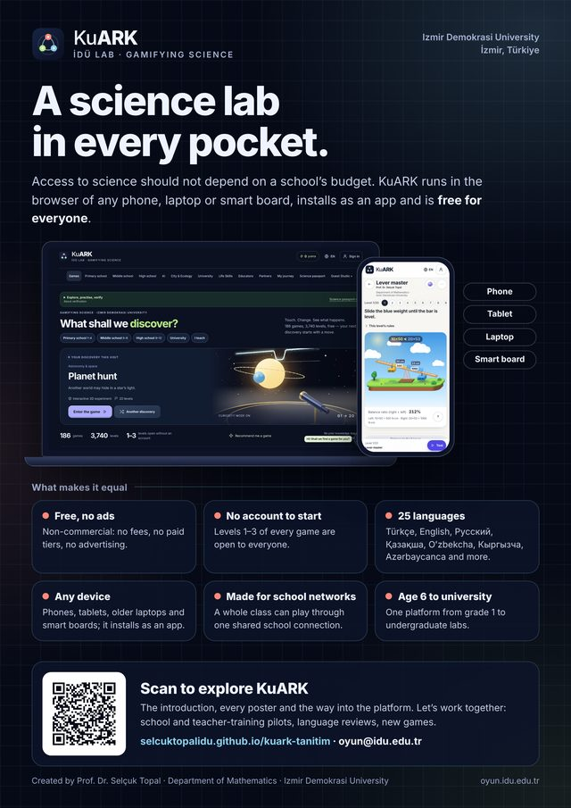
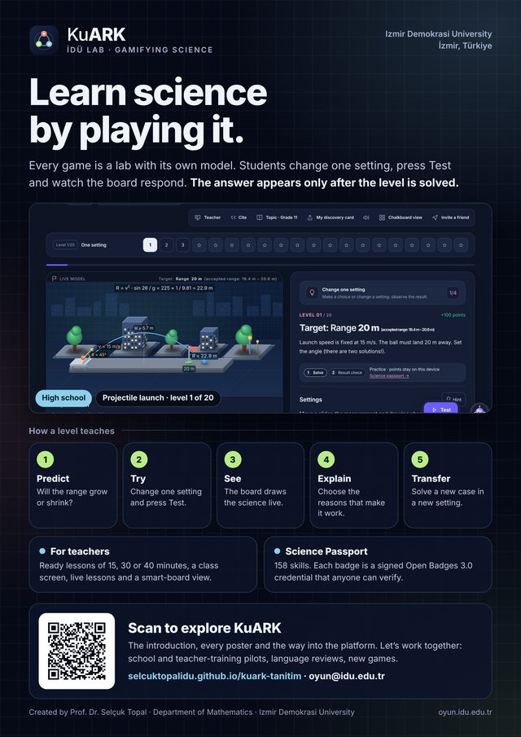
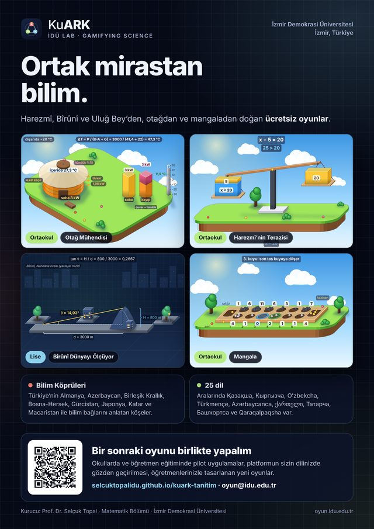

# KuARK · İDÜ Lab

**The same science lab for every learner.** 186 free science games and 3,740 levels, from primary school to university, in 25 languages.

**Her öğrenciye aynı bilim laboratuvarı.** İlkokuldan üniversiteye 186 ücretsiz bilim oyunu ve 3.740 seviye, 25 dilde.

- Introduction page / Tanıtım sayfası: **https://selcuktopalidu.github.io/kuark-tanitim/**
- Platform: **https://oyun.idu.edu.tr** (opening soon / yakında açılıyor)
- Contact / İletişim: **oyun@idu.edu.tr**

## Posters (English)

<table>
<tr>
<td></td>
<td></td>
<td></td>
<td></td>
</tr>
</table>

1. The same science lab for every learner: [PDF](afisler/1-equal-lab-en.pdf) · [JPG](afisler/1-equal-lab-en.jpg)
2. A science lab in every pocket: [PDF](afisler/2-lab-in-every-pocket-en.pdf) · [JPG](afisler/2-lab-in-every-pocket-en.jpg)
3. Learn science by playing it: [PDF](afisler/3-learn-by-playing-en.pdf) · [JPG](afisler/3-learn-by-playing-en.jpg)
4. Science from a shared heritage: [PDF](afisler/4-shared-heritage-en.pdf) · [JPG](afisler/4-shared-heritage-en.jpg)

All four in one PDF: [KuARK-posters-en.pdf](afisler/KuARK-posters-en.pdf)

## Afişler (Türkçe)

<table>
<tr>
<td></td>
<td></td>
<td></td>
<td></td>
</tr>
</table>

1. Her öğrenciye aynı bilim laboratuvarı: [PDF](afisler/1-ayni-laboratuvar-tr.pdf) · [JPG](afisler/1-ayni-laboratuvar-tr.jpg)
2. Her cepte bir bilim laboratuvarı: [PDF](afisler/2-her-cepte-laboratuvar-tr.pdf) · [JPG](afisler/2-her-cepte-laboratuvar-tr.jpg)
3. Bilimi oynayarak öğren: [PDF](afisler/3-oynayarak-ogren-tr.pdf) · [JPG](afisler/3-oynayarak-ogren-tr.jpg)
4. Ortak mirastan bilim: [PDF](afisler/4-ortak-miras-tr.pdf) · [JPG](afisler/4-ortak-miras-tr.jpg)

Dört afiş tek PDF’te: [KuARK-afisler-tr.pdf](afisler/KuARK-afisler-tr.pdf)

## QR cards / QR kartları

Ten 85 × 55 mm cards on one A4 sheet, with crop marks. / Bir A4’te kesim işaretli on kart (85 × 55 mm): [PDF](afisler/qr-kartlari.pdf) · [JPG](afisler/qr-kartlari.jpg)

---

Created by Prof. Dr. Selçuk Topal · Department of Mathematics · Izmir Demokrasi University · [LinkedIn](https://www.linkedin.com/in/selcuktopal80)
