# KuARK · İDÜ Lab

**The same science lab for every learner.** 150+ free science games and 3,000+ levels, from primary school to university, in 26 languages.

**Her öğrenciye aynı bilim laboratuvarı.** İlkokuldan üniversiteye 150’den fazla ücretsiz bilim oyunu ve 3.000’den fazla seviye, 26 dilde.

- Introduction page / Tanıtım sayfası: **https://selcuktopalidu.github.io/kuark-tanitim/**
- Platform: **https://oyun.idu.edu.tr** (opening soon / yakında açılıyor)
- Live demo / Canlı demo: **https://kuark-production.up.railway.app**
- Contact / İletişim: **oyun@idu.edu.tr**

## Posters (English)

<table>
<tr>
<td><a href="afisler/1-equal-lab-en.pdf">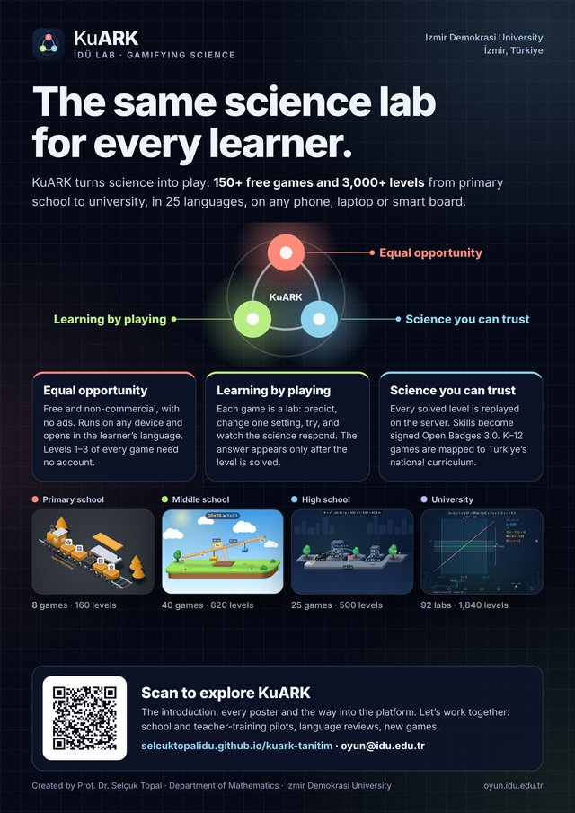</a></td>
<td></td>
<td></td>
<td><a href="afisler/4-shared-heritage-en.pdf">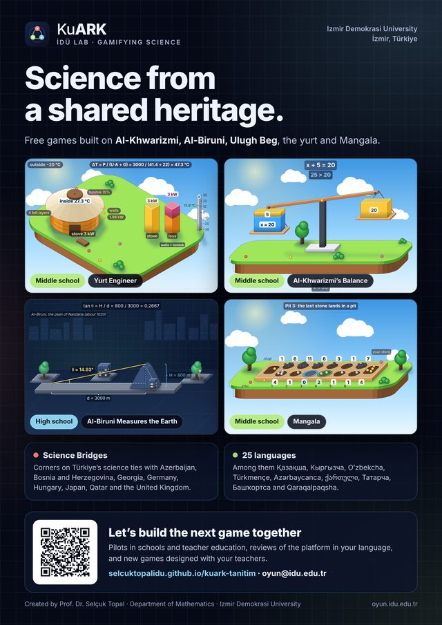</a></td>
</tr>
</table>

1. The same science lab for every learner: [PDF](afisler/1-equal-lab-en.pdf) · [JPG](afisler/1-equal-lab-en.jpg)
2. A science lab in every pocket: [PDF](afisler/2-lab-in-every-pocket-en.pdf) · [JPG](afisler/2-lab-in-every-pocket-en.jpg)
3. Learn science by playing it: [PDF](afisler/3-learn-by-playing-en.pdf) · [JPG](afisler/3-learn-by-playing-en.jpg)
4. Science from a shared heritage: [PDF](afisler/4-shared-heritage-en.pdf) · [JPG](afisler/4-shared-heritage-en.jpg)

All four in one PDF: [KuARK-posters-en.pdf](afisler/KuARK-posters-en.pdf)

## Going Global 2026, İstanbul (English, five pages)

<table>
<tr>
<td><a href="afisler/going-global-1-en.pdf">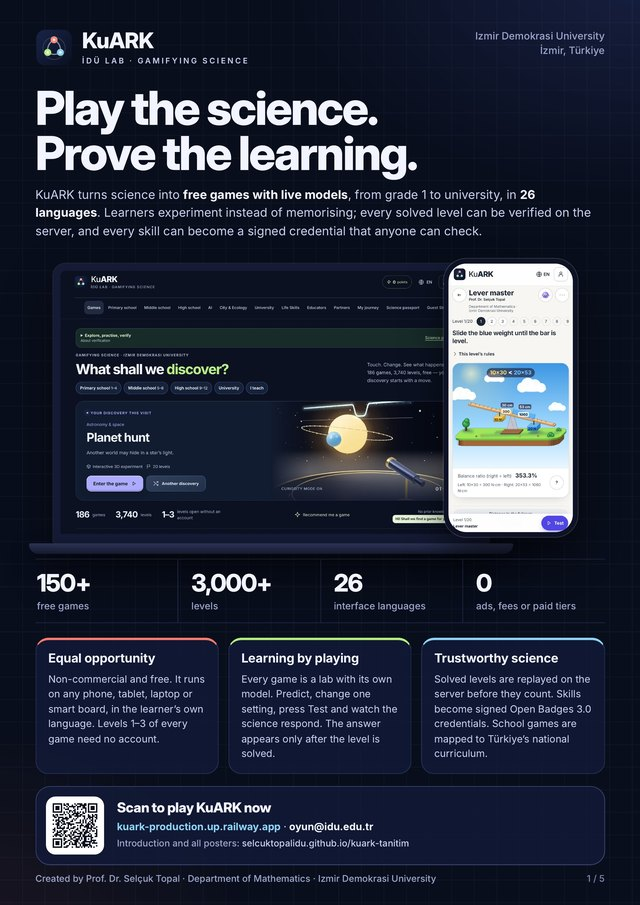</a></td>
<td><a href="afisler/going-global-2-en.pdf">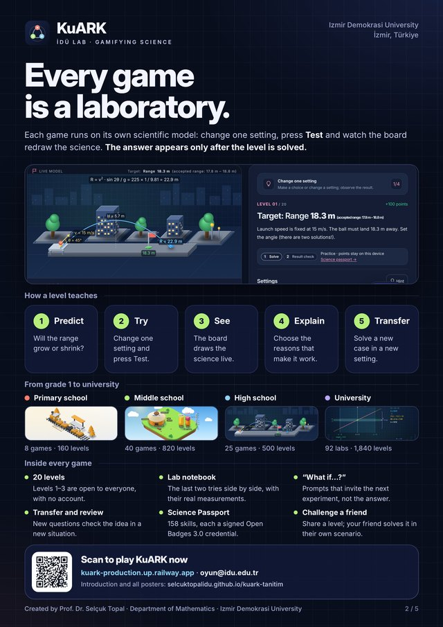</a></td>
<td><a href="afisler/going-global-3-en.pdf">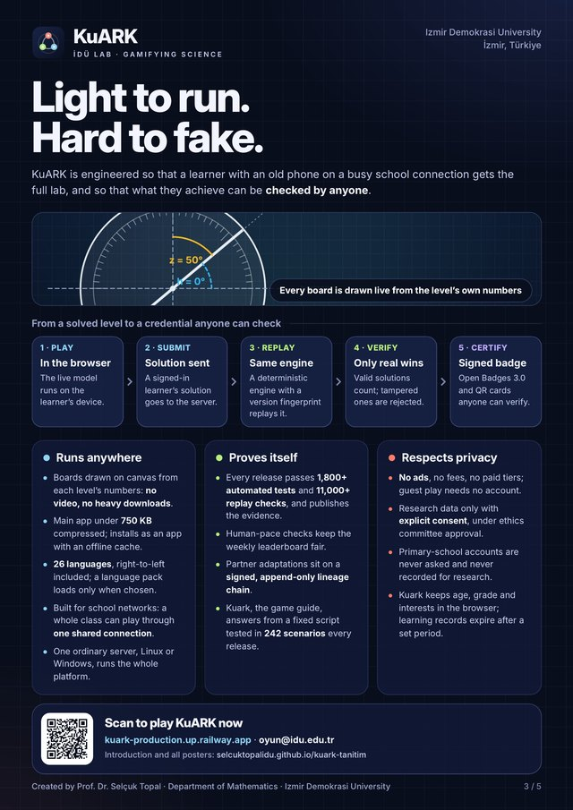</a></td>
<td><a href="afisler/going-global-4-en.pdf">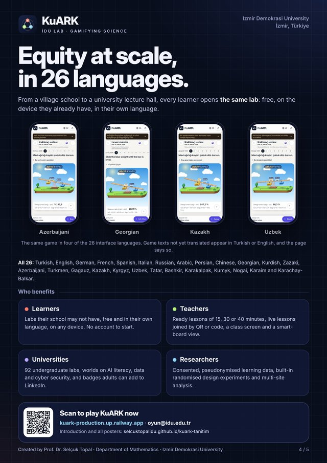</a></td>
<td><a href="afisler/going-global-5-en.pdf">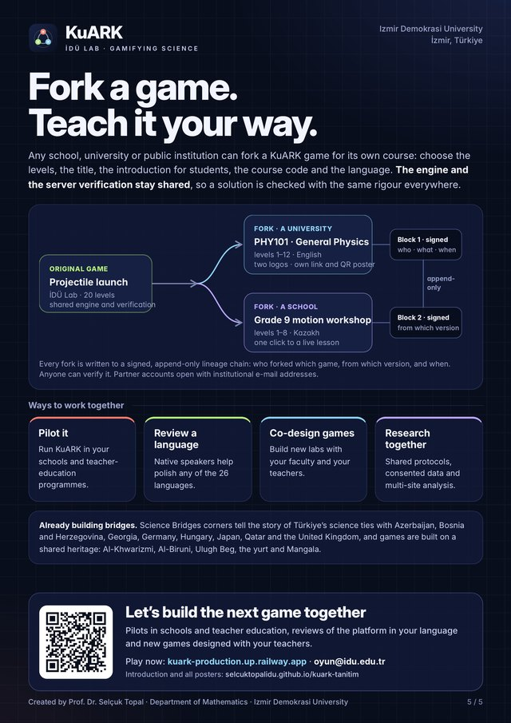</a></td>
</tr>
</table>

1. Play the science. Prove the learning. [PDF](afisler/going-global-1-en.pdf) · [JPG](afisler/going-global-1-en.jpg)
2. Every game is a laboratory. [PDF](afisler/going-global-2-en.pdf) · [JPG](afisler/going-global-2-en.jpg)
3. Light to run. Hard to fake. [PDF](afisler/going-global-3-en.pdf) · [JPG](afisler/going-global-3-en.jpg)
4. Equity at scale, in 26 languages. [PDF](afisler/going-global-4-en.pdf) · [JPG](afisler/going-global-4-en.jpg)
5. Fork a game. Teach it your way. [PDF](afisler/going-global-5-en.pdf) · [JPG](afisler/going-global-5-en.jpg)

All five pages in one PDF: [KuARK-going-global-en.pdf](afisler/KuARK-going-global-en.pdf)

## Afişler (Türkçe)

<table>
<tr>
<td><a href="afisler/1-ayni-laboratuvar-tr.pdf">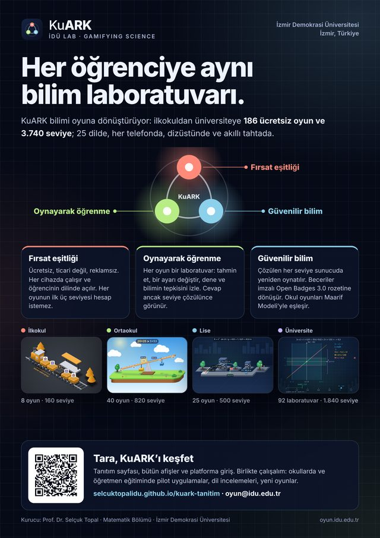</a></td>
<td><a href="afisler/2-her-cepte-laboratuvar-tr.pdf">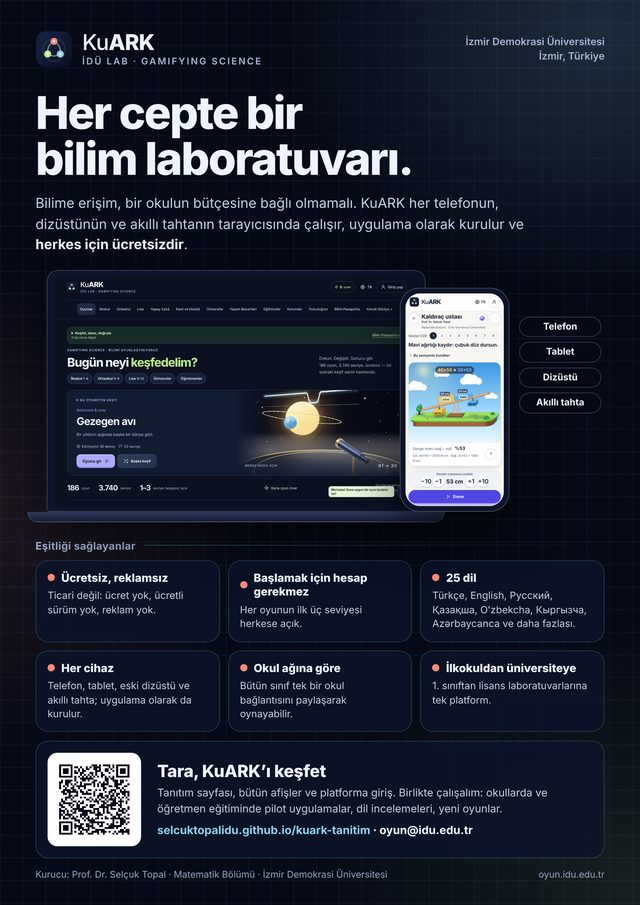</a></td>
<td><a href="afisler/3-oynayarak-ogren-tr.pdf">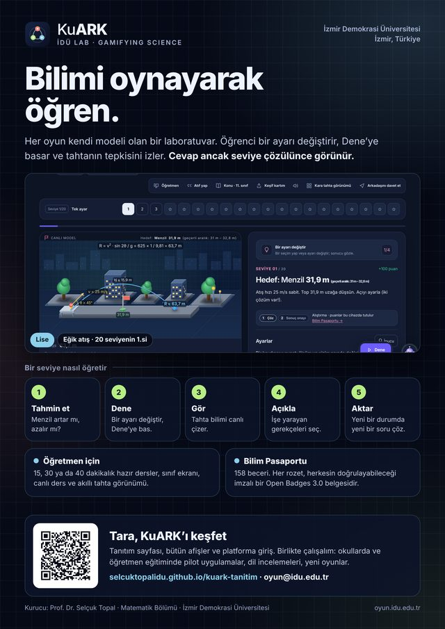</a></td>
<td></td>
</tr>
</table>

1. Her öğrenciye aynı bilim laboratuvarı: [PDF](afisler/1-ayni-laboratuvar-tr.pdf) · [JPG](afisler/1-ayni-laboratuvar-tr.jpg)
2. Her cepte bir bilim laboratuvarı: [PDF](afisler/2-her-cepte-laboratuvar-tr.pdf) · [JPG](afisler/2-her-cepte-laboratuvar-tr.jpg)
3. Bilimi oynayarak öğren: [PDF](afisler/3-oynayarak-ogren-tr.pdf) · [JPG](afisler/3-oynayarak-ogren-tr.jpg)
4. Ortak mirastan bilim: [PDF](afisler/4-ortak-miras-tr.pdf) · [JPG](afisler/4-ortak-miras-tr.jpg)

Dört afiş tek PDF’te: [KuARK-afisler-tr.pdf](afisler/KuARK-afisler-tr.pdf)

## QR cards / QR kartları

Ten 85 × 55 mm cards on one A4 sheet, with crop marks. / Bir A4’te kesim işaretli on kart (85 × 55 mm): [PDF](afisler/qr-kartlari.pdf) · [JPG](afisler/qr-kartlari.jpg)

## Okul sunumları · School presentations

Okul ziyaretleri için dört sunum (Türkçe, 16:9 PDF). / Four decks for school visits (in Turkish, 16:9 PDF).

<table>
<tr>
<td><a href="sunumlar/KuARK-ilkokul-sunumu.pdf">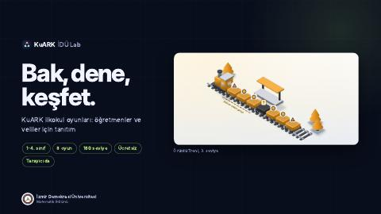</a></td>
<td></td>
<td></td>
<td><a href="sunumlar/KuARK-universite-sunumu.pdf">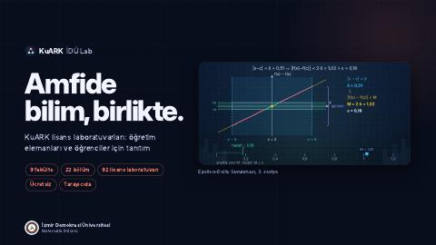</a></td>
</tr>
</table>

- [İlkokul · Primary school](sunumlar/KuARK-ilkokul-sunumu.pdf) · 12 slayt
- [Ortaokul · Middle school](sunumlar/KuARK-ortaokul-sunumu.pdf) · 15 slayt
- [Lise · High school](sunumlar/KuARK-lise-sunumu.pdf) · 15 slayt
- [Üniversite · University](sunumlar/KuARK-universite-sunumu.pdf) · 13 slayt

**Bir oyunu dersin için çatalla · Fork a game for your course** (8 dil · 8 languages, 11 slayt):
[Türkçe](sunumlar/catallama/KuARK-catallama-tr.pdf) · [English](sunumlar/catallama/KuARK-catallama-en.pdf) · [Français](sunumlar/catallama/KuARK-catallama-fr.pdf) · [Italiano](sunumlar/catallama/KuARK-catallama-it.pdf) · [العربية](sunumlar/catallama/KuARK-catallama-ar.pdf) · [Deutsch](sunumlar/catallama/KuARK-catallama-de.pdf) · [Español](sunumlar/catallama/KuARK-catallama-es.pdf) · [Русский](sunumlar/catallama/KuARK-catallama-ru.pdf)

## Videolar · Videos

- [Platform tanıtımı · Platform introduction](videolar/platform-tanitimi/) · 2 video
- [Kısa videolar (dikey) · Shorts (vertical)](videolar/kisa-videolar/) · 2 video
- [Why gamify science? · Bilimi neden oyunlaştırıyoruz?](videolar/neden-bilimi-oyunlastiriyoruz/) · 1 video
- [Being … at İDÜ Lab · İDÜ Lab’de …](videolar/kisi-filmleri/) · 7 video
- [Her oyun, her köşe: 3. seviye · Every game, every corner: level 3](videolar/her-oyun-her-kose/) · 2 video
- [Ders filmleri (canlandırma) · Lesson films (dramatised)](videolar/ders-filmleri/) · 4 video
- [Bir oyunu dersin için çatalla · Fork a game for your course](videolar/catallama/) · 5 video
- [Bir KuARK oyunu nasıl zorlaşır? · How a KuARK game gets harder](videolar/zorluk-mantigi/) · 2 video
- [ArdenBot: Tahtadaki sınıf yardımcısı · ArdenBot: The class helper on the board](videolar/ardenbot/) · 2 video
- [Kuark: Sana göre oyunu bulan rehber · Kuark: The guide who finds your game](videolar/kuark/) · 2 video
- [Farkındalık köşeleri · Awareness corners](videolar/farkindalik-koseleri/) · 2 video

## Sosyal medya görselleri · Social media images

- [YouTube kanal görselleri · YouTube channel art](sosyal-medya/youtube/)
- [Instagram](sosyal-medya/instagram/)

---

Created by Prof. Dr. Selçuk Topal · Department of Mathematics · Izmir Demokrasi University · [LinkedIn](https://www.linkedin.com/in/selcuktopal80)
