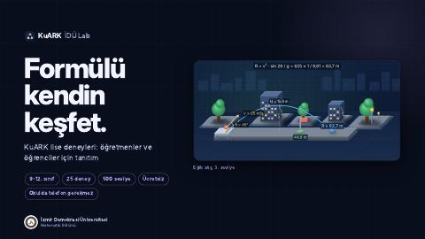

# Okul sunumları · School presentations

İlkokul, ortaokul, lise ve üniversite ziyaretleri için dört sunum (Türkçe, 16:9 PDF): KuARK nedir, bir seviye nasıl öğretir,
oyunlar, zorluğun aşamaları, tahta modu, bilgisayar laboratuvarında canlı ders, 40 dakikalık ders akışı, Türkiye Yüzyılı
Maarif Modeli ile uyum, güvenlik ve gizlilik, öğretmen araçları; üniversite sunumunda amfi yarışması, çatallama ve araştırma.

Four decks for visits to primary, middle and high schools and universities (in Turkish, 16:9 PDF).

**Paylaşım metinleri · Post texts:** [paylasim-metinleri.md](paylasim-metinleri.md) (başlık, açıklama, etiketler, hashtagler ve kısa paylaşımlar · titles, descriptions, tags, hashtags and short posts)

| Sunum · Deck | Slayt · Slides |
| --- | --- |
| [İlkokul · Primary school](KuARK-ilkokul-sunumu.pdf) | 12 |
| [Ortaokul · Middle school](KuARK-ortaokul-sunumu.pdf) | 15 |
| [Lise · High school](KuARK-lise-sunumu.pdf) | 15 |
| [Üniversite · University](KuARK-universite-sunumu.pdf) | 13 |

## Bir oyunu dersin için çatalla · Fork a game for your course

Kurum ortaklığı ve çatal sistemi, sekiz dilde (16:9 PDF, 11 slayt). İtalyanca, Almanca, İspanyolca ve Rusça sunumlarda ekran görüntüleri İngilizce arayüzdendir; görüntülerdeki kurumlar örnektir.

Institution partnership and the fork system in eight languages (16:9 PDF, 11 slides). The Italian, German, Spanish and Russian decks show the English interface; the institutions on screen are examples.

- [Türkçe](catallama/KuARK-catallama-tr.pdf)
- [English](catallama/KuARK-catallama-en.pdf)
- [Français](catallama/KuARK-catallama-fr.pdf)
- [Italiano](catallama/KuARK-catallama-it.pdf)
- [العربية](catallama/KuARK-catallama-ar.pdf)
- [Deutsch](catallama/KuARK-catallama-de.pdf)
- [Español](catallama/KuARK-catallama-es.pdf)
- [Русский](catallama/KuARK-catallama-ru.pdf)

   

Created by Prof. Dr. Selçuk Topal · Department of Mathematics · Izmir Demokrasi University · oyun@idu.edu.tr
