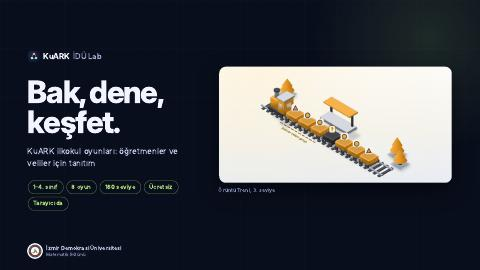
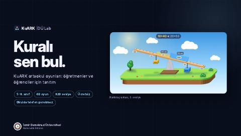
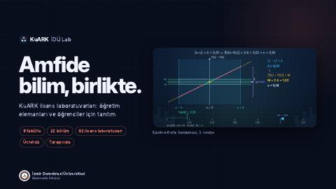

# Okul sunumları · School presentations

İlkokul, ortaokul, lise ve üniversite ziyaretleri için dört sunum (Türkçe, 16:9 PDF): KuARK nedir, bir seviye nasıl öğretir,
oyunlar, zorluğun aşamaları, tahta modu, bilgisayar laboratuvarında canlı ders, 40 dakikalık ders akışı, Türkiye Yüzyılı
Maarif Modeli ile uyum, güvenlik ve gizlilik, öğretmen araçları; üniversite sunumunda amfi yarışması, çatallama ve araştırma.

Four decks for visits to primary, middle and high schools and universities (in Turkish, 16:9 PDF).

| Sunum · Deck | Slayt · Slides |
| --- | --- |
| [İlkokul · Primary school](KuARK-ilkokul-sunumu.pdf) | 12 |
| [Ortaokul · Middle school](KuARK-ortaokul-sunumu.pdf) | 15 |
| [Lise · High school](KuARK-lise-sunumu.pdf) | 15 |
| [Üniversite · University](KuARK-universite-sunumu.pdf) | 13 |

   

Created by Prof. Dr. Selçuk Topal · Department of Mathematics · Izmir Demokrasi University · oyun@idu.edu.tr
