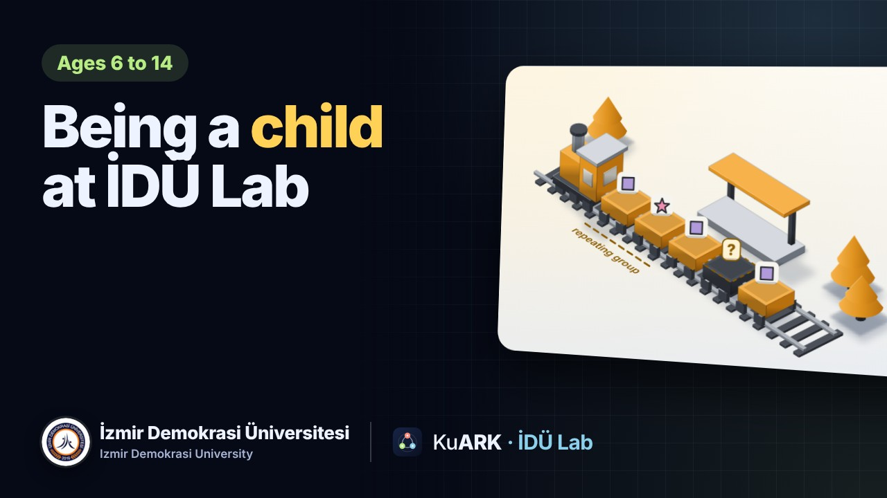
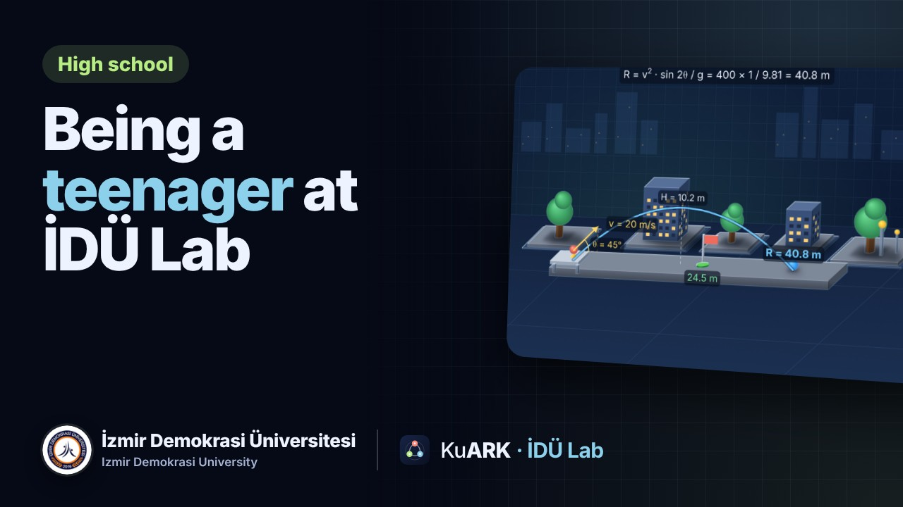
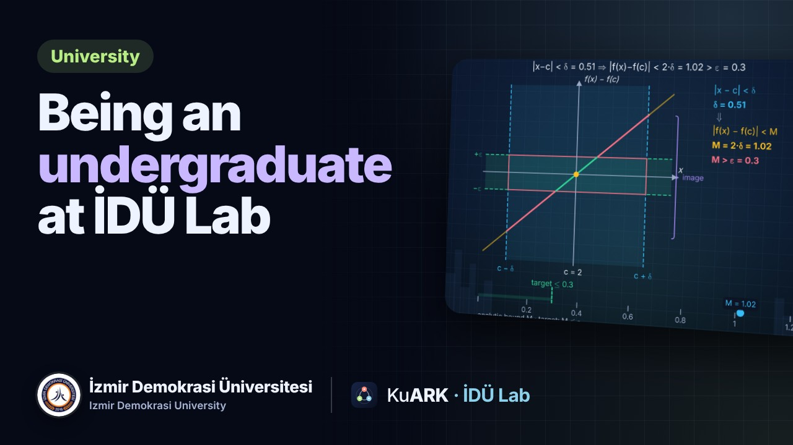
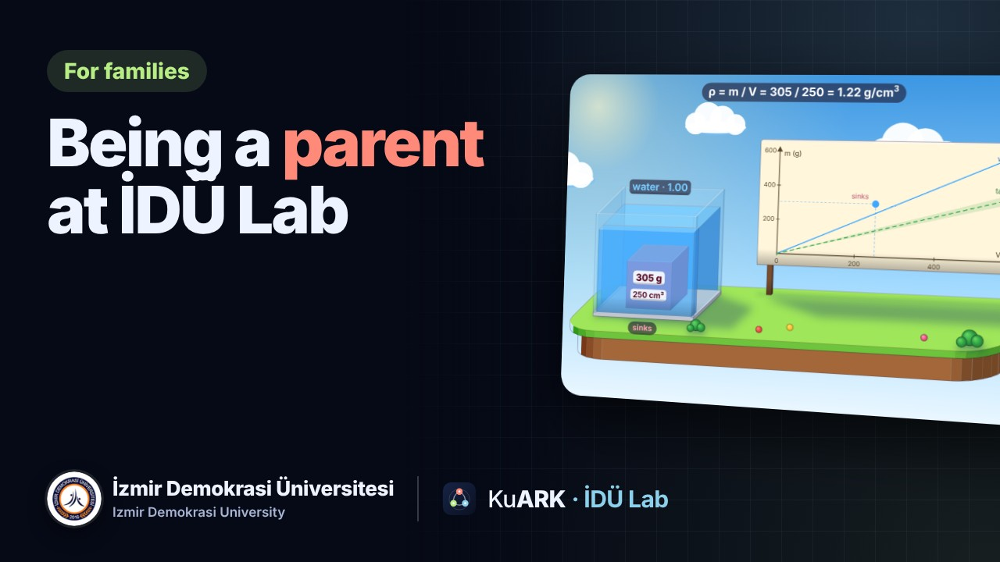
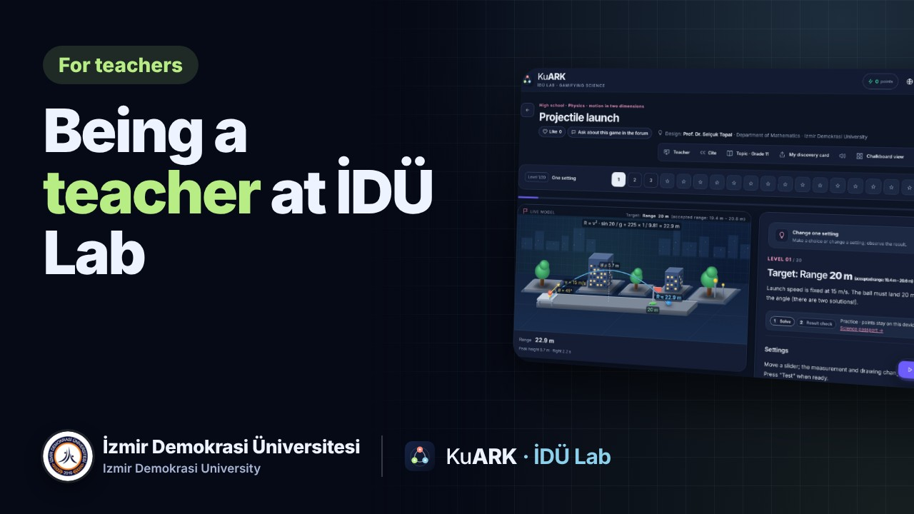
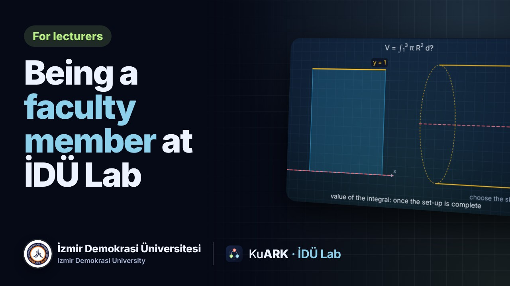
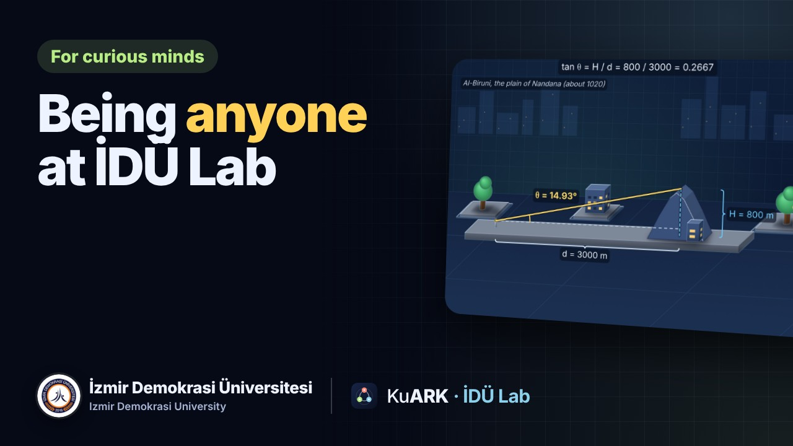

# Being … at İDÜ Lab · İDÜ Lab’de …

Seven films, about three minutes each, on what the platform offers a child, a teenager, an undergraduate, a parent, a teacher, a faculty member and anyone; English subtitles.

Bir çocuğa, gence, lisans öğrencisine, veliye, öğretmene, öğretim üyesine ve herkese platformun neler sunduğunu anlatan yedi film, her biri yaklaşık üç dakika; İngilizce alt yazılı.

**Paylaşım metinleri · Post texts:** [paylasim-metinleri.md](paylasim-metinleri.md) (başlık, açıklama, etiketler, hashtagler ve kısa paylaşımlar · titles, descriptions, tags, hashtags and short posts)

| Video | Dil · Language | Süre · Length | Alt yazı · Subtitles |
| --- | --- | --- | --- |
| [Being a child](being-a-child.mp4) | English | 2:57 | [SRT](being-a-child.en.srt) |
| [Being a teenager](being-a-teenager.mp4) | English | 2:57 | [SRT](being-a-teenager.en.srt) |
| [Being an undergraduate](being-an-undergraduate.mp4) | English | 2:57 | [SRT](being-an-undergraduate.en.srt) |
| [Being a parent](being-a-parent.mp4) | English | 2:57 | [SRT](being-a-parent.en.srt) |
| [Being a teacher](being-a-teacher.mp4) | English | 2:57 | [SRT](being-a-teacher.en.srt) |
| [Being a faculty member](being-a-faculty-member.mp4) | English | 2:57 | [SRT](being-a-faculty-member.en.srt) |
| [Being anyone](being-anyone.mp4) | English | 2:57 | [SRT](being-anyone.en.srt) |

      

Created by Prof. Dr. Selçuk Topal · Department of Mathematics · Izmir Demokrasi University · oyun@idu.edu.tr
