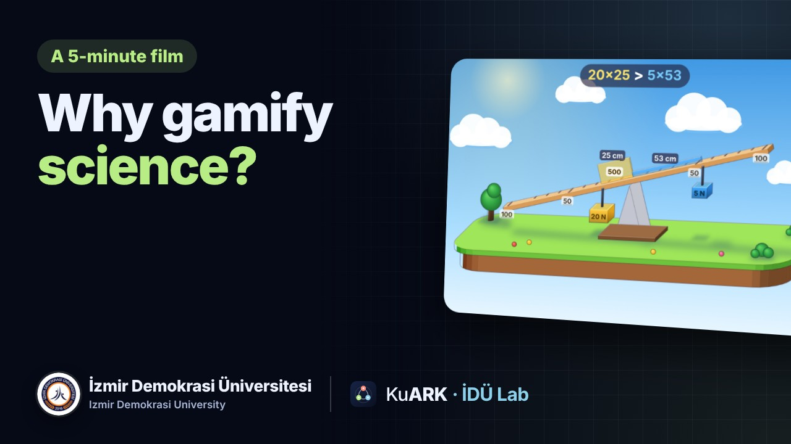

# Why gamify science? · Bilimi neden oyunlaştırıyoruz?

Five-minute film on the reasons behind the platform, with English subtitles.

Platformun gerekçelerini anlatan beş dakikalık film, İngilizce alt yazılı.

| Video | Dil · Language | Süre · Length | Alt yazı · Subtitles |
| --- | --- | --- | --- |
| [Why gamify science?](why-gamify-science.mp4) | English | 4:57 | [SRT](why-gamify-science.en.srt) |

Created by Prof. Dr. Selçuk Topal · Department of Mathematics · Izmir Demokrasi University · oyun@idu.edu.tr
