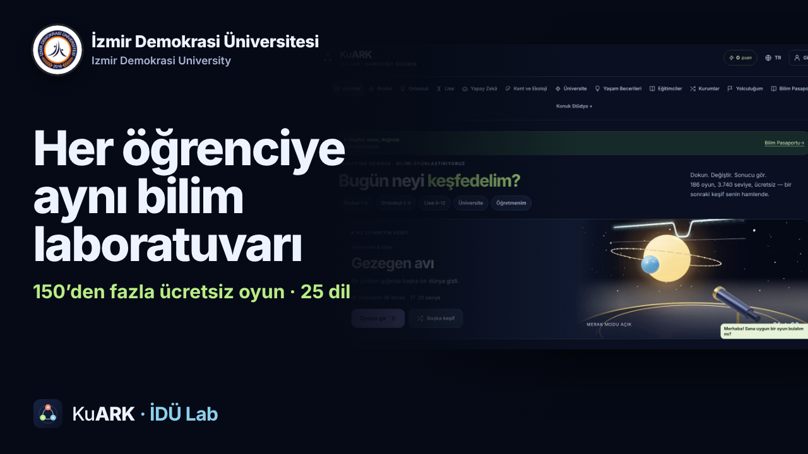
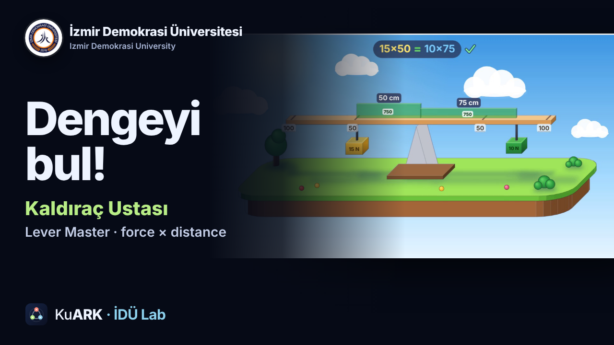

# Platform tanıtımı · Platform introduction

Platformun iki dakikalık tanıtımı ve Kaldıraç Ustası oyununun tam turu (Türkçe).

A two-minute introduction to the platform and a full round of the Lever Master game (in Turkish).

| Video | Dil · Language | Süre · Length | Alt yazı · Subtitles |
| --- | --- | --- | --- |
| [Her öğrenciye aynı bilim laboratuvarı](video1-platform-tanitimi.mp4) | Türkçe | 2:11 | — |
| [Kaldıraç Ustası: tam tur](video2-kaldirac-ustasi.mp4) | Türkçe | 1:04 | — |

 

Created by Prof. Dr. Selçuk Topal · Department of Mathematics · Izmir Demokrasi University · oyun@idu.edu.tr
